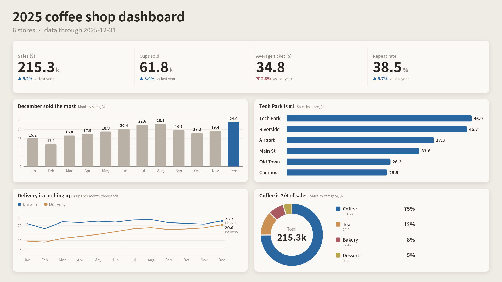
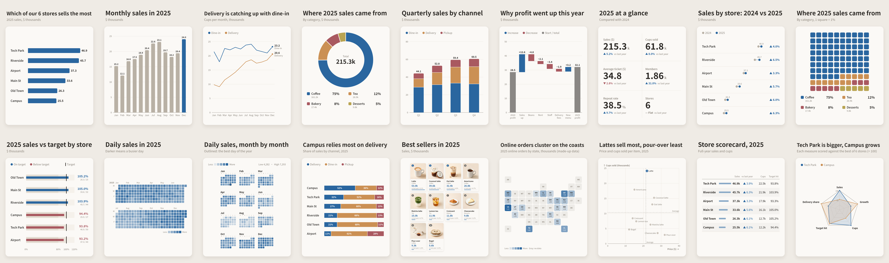
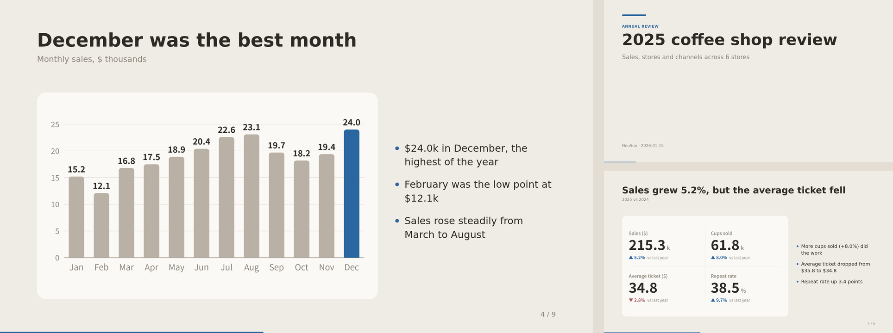

# AI Data Report Skill — say what you want to know, get the right charts and a finished report

An **agent skill** for Claude Code and other AI assistants. Tell it what you want to know ("which store has a problem?", "how did we do this year?"); it works out which charts answer that question and builds **report-ready charts, a one-page dashboard, a printable report or an HTML slide deck**. The data can come from Excel, CSV, a pasted table, a database or BI query, or numbers you type. No internet needed: the AI writes one HTML file, you open it in a browser.

[中文说明](README.zh-CN.md) · by **NeoSun**



## Features

- **Starts from your question, not the chart type**: common requests map to a report plan, for example "which store has a problem?" → KPI cards, who missed the target (bullet), who dropped vs. last year (dumbbell), when it dropped (calendar heatmap). Charts the data can't support are left out, with a reason.
- **Doesn't overstate**: no invented benchmarks, no "because" without evidence, careful wording for small samples, and every vague claim replaced by a number.
- **Four outputs from the same data**:
  - **Charts**: every chart as a 3:4 PNG (phones), a 16:9 PNG (slides) and a transparent "chart only" PNG that fits any template.
  - **Dashboards**: a row of KPI cards plus 2–6 charts on one page, as a 16:9 slide or a long phone image.
  - **Reports**: one long page with key findings, a chart and explanation per section and notes on the data; prints neatly to A4 PDF.
  - **Slides**: a 16:9 HTML deck with arrow-key navigation and full screen; prints one slide per PDF page.
- **Works with other slide skills and templates**: using [frontend-slides](https://github.com/zarazhangrui/frontend-slides), another presentation skill or your company template? This skill writes the storyline and draws the charts in that deck's colors and font, and leaves the design alone. HTML decks get an embed snippet; PowerPoint, Keynote and Google Slides get transparent PNGs.
- **17 chart types**: bar, column, line, donut, stacked column, waterfall, KPI cards, dumbbell, waffle, bullet, calendar heatmap (one row for the year), month calendar heatmap, image cards (a product wall with pictures and rankings), tile map (US states or Chinese provinces, offline, no borders), scatter, radar, table. Bars and columns also come **grouped, stacked and 100% stacked**, for comparing several numbers or the mix across items.
- **3 built-in themes or your own colors**: Oat Latte, Mist Blue, Midnight Navy (dark), or any palette you pass in.
- **Built for people new to data**: the AI first asks who it's for, which numbers matter and what to compare with; cleans messy spreadsheets (several sheets, merged cells, dates stored as text, "$3,200" as text) and tells you what it changed.
- **No made-up numbers**: every value comes from your data, and the AI explains how it summarized.
- **Any data source**: Excel, CSV, a pasted table, the results of a database or Power BI query (for example through an MCP server), or numbers in the chat.
- **English and Chinese** chart text.



| Report | Slides |
|---|---|
|  |  |

## Install

**Claude Code (plugin)**:

```
/plugin marketplace add NeoSunxz/ai-data-report-skill
/plugin install data-report@neosun-skills
```

**Any agent that supports the skills CLI** (Claude Code, Codex, Cursor and others):

```bash
npx skills add NeoSunxz/ai-data-report-skill
```

**By hand**: copy the `skills/data-report` folder into `~/.claude/skills/` (all projects) or `.claude/skills/` in your project.

```bash
git clone https://github.com/NeoSunxz/ai-data-report-skill.git
cp -r ai-data-report-skill/skills/data-report ~/.claude/skills/
```

**Other AI assistants**: attach `skills/data-report/SKILL.md` and `skills/data-report/template.html`, and say "follow these instructions".

## Use

1. Give the AI your data and say what you want to know or what you need: "which store is falling behind?", "when are our busy seasons?", "build me a dashboard", "make 6 slides from this data".
2. It creates an HTML file. Open it in Chrome or Edge.
   - Charts and dashboards: click the download buttons.
   - Reports: "Print / save as PDF" at the top.
   - Slides: ← → to move, F for full screen, print to save as PDF.

To see it first, open the examples in a browser: [`demo.html`](examples/demo.html) (charts and dashboard), [`report.html`](examples/report.html), [`slides.html`](examples/slides.html). They use made-up coffee shop data.

## Limits

- In the browser, hover over a chart to see exact values; there is no clicking or filtering. Regenerate when the data changes.
- Built-in slides are deliberately plain (headline, chart, a few points). For animated, highly designed decks, pair it with a presentation skill.
- Each chart has a row limit (for example 15 bars, 4 lines), so large data is summarized first.
- Text uses the fonts on your computer, so letter shapes differ slightly between machines.
- The page runs only in your browser and never uploads your data.

## License

[MIT](LICENSE) © NeoSun
