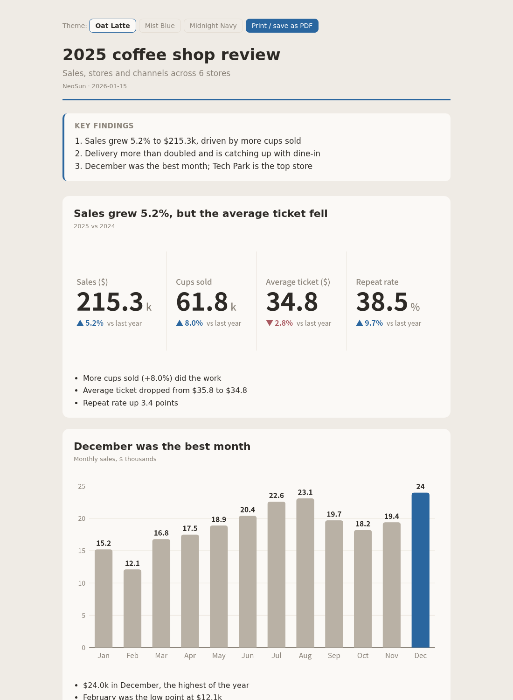

# Excel Charts Skill — turn Excel / CSV into charts, dashboards, reports and slides with AI

An **agent skill** for Claude Code and other AI assistants that turns a spreadsheet (Excel, CSV or a pasted table) into **report-ready charts, one-page dashboards, printable reports and HTML slide decks**. No install, no internet: the AI writes one HTML file, you open it in a browser.

[中文说明](README.zh-CN.md) · by **NeoSun**


## Features

- **Four outputs from the same data**:
  - **Charts**: every chart as a 3:4 PNG (phones), a 16:9 PNG (slides) and a transparent "chart only" PNG that fits any template.
  - **Dashboards**: a row of KPI cards plus 2–6 charts on one page, as a 16:9 slide or a long phone image.
  - **Reports**: one long page with key findings, a chart and explanation per section and notes on the data; prints neatly to A4 PDF.
  - **Slides**: a 16:9 HTML deck with arrow-key navigation and full screen; prints one slide per PDF page.
- **Works with other slide skills and templates**: using [frontend-slides](https://github.com/zarazhangrui/frontend-slides), another presentation skill or your company template? This skill writes the storyline and draws the charts in that deck's colors and font, and leaves the design alone. HTML decks get an embed snippet; PowerPoint, Keynote and Google Slides get transparent PNGs.
- **11 chart types**: bar, column, line, donut, stacked column, waterfall, KPI cards, dumbbell, waffle, bullet, calendar heatmap.
- **3 built-in themes or your own colors**: Oat Latte, Mist Blue, Midnight Navy (dark), or any palette you pass in.
- **Built for people new to data**: the AI first asks who it's for, which numbers matter and what to compare with; cleans messy spreadsheets (several sheets, merged cells, dates stored as text, "$3,200" as text) and tells you what it changed.
- **No made-up numbers**: every value comes from your data, and the AI explains how it summarized.
- **English and Chinese** chart text.


| Report | Slides |
|---|---|
|  |  |

## Install

**Claude Code**: copy the `skills/excel-charts` folder into `~/.claude/skills/` (all projects) or `.claude/skills/` in your project.

```bash
git clone https://github.com/NeoSunxz/excel-charts-skill.git
cp -r excel-charts-skill/skills/excel-charts ~/.claude/skills/
```

**Other AI assistants** (any tool that reads Agent Skills, or none at all): attach `skills/excel-charts/SKILL.md` and say "follow these instructions".

## Use

1. Give the AI your spreadsheet and say what you need: "chart this", "build me a dashboard", "write a report on this", "make 6 slides from this data".
2. It creates an HTML file. Open it in Chrome or Edge.
   - Charts and dashboards: click the download buttons.
   - Reports: "Print / save as PDF" at the top.
   - Slides: ← → to move, F for full screen, print to save as PDF.

To see it first, open the examples in a browser: [`demo.html`](examples/demo.html) (charts and dashboard), [`report.html`](examples/report.html), [`slides.html`](examples/slides.html). They use made-up coffee shop data.

## Limits

- Static charts: no clicking or filtering; regenerate when the data changes.
- Built-in slides are deliberately plain (headline, chart, a few points). For animated, highly designed decks, pair it with a presentation skill.
- Each chart has a row limit (for example 15 bars, 4 lines), so large data is summarized first.
- Text uses the fonts on your computer, so letter shapes differ slightly between machines.
- The page runs only in your browser and never uploads your data.

## License

[MIT](LICENSE) © NeoSun
