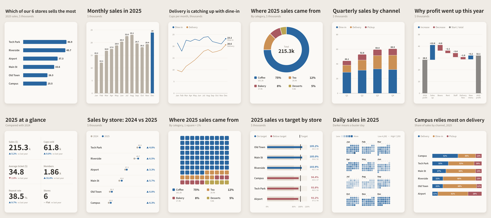

# Excel Charts Skill：用 AI 把 Excel / CSV 做成图表、看板、报告和幻灯片

一个给 Claude Code 等 AI 助手用的 **Skill**：把 Excel、CSV 或粘贴的表格，做成能直接用的**图表、一页数据看板、可打印的报告和 HTML 幻灯片**。不用安装，不联网：AI 生成一个 HTML 文件，用浏览器打开就行。

[English](README.md) · 作者 **NeoSun**


## 能做什么

- **同一份数据，四种输出**：
  - **图片**：每张图有 3:4（手机）、16:9（PPT）和透明背景的「只下载图」，放进任何模板都行。
  - **看板**：一排数字卡加 2–6 张图拼成一页，16:9 或手机长图。
  - **报告**：一个长网页：主要发现、每节一张图配解读、数据说明；能打印成 A4 PDF。
  - **幻灯片**：16:9 的 HTML 幻灯片，方向键翻页、可全屏，打印成 PDF 一页一张。
- **和别的幻灯片 Skill、模板一起用**：在用 [frontend-slides](https://github.com/zarazhangrui/frontend-slides)、别的做 PPT 的 Skill 或公司模板？这个 Skill 只写内容大纲、按对方的颜色和字体画图，不动对方的设计。HTML 幻灯片给嵌入代码，PowerPoint、Keynote、WPS 给透明背景 PNG。
- **11 种图**：条形图、柱形图、折线图、环形图、堆积柱形图、瀑布图、数字卡、哑铃图、华夫饼图、子弹图、日历热力图。条形图和柱形图还能画成**分组、堆积和 100% 堆积**，用来并排比较几组数，或者比较各项的构成。
- **3 套配色或你自己的颜色**：燕麦拿铁、雾霾蓝、深夜蓝（深色），也可以传入任何一套颜色。
- **不懂数据也能用**：AI 先问给谁看、最关心哪几个数、和什么比；表格里有多个 sheet、合并单元格、日期写成文字这类情况，它会先整理，再告诉你改了什么。
- **不编数**：图里的每个数都来自你的表格，汇总时会说明怎么算的。
- **中英文**：示例是英文的；用中文跟 AI 说，它就出中文的图和页面。



| 报告 | 幻灯片 |
|---|---|
|  |  |

## 安装

**Claude Code**：把 `skills/excel-charts` 文件夹复制到 `~/.claude/skills/`（所有项目可用）或项目里的 `.claude/skills/`。

```bash
git clone https://github.com/NeoSunxz/excel-charts-skill.git
cp -r excel-charts-skill/skills/excel-charts ~/.claude/skills/
```

**其他 AI 助手**：把 `skills/excel-charts/SKILL.md` 当附件发给它，说「按这份说明做」。Skill 正文是英文，用中文跟 AI 说话就行，它会出中文图。

## 怎么用

1. 把表格交给 AI，说你要什么：「画成图」「做个看板」「写份报告」「做成 6 页 PPT」。
2. AI 会生成一个 HTML 文件，用 Chrome 或 Edge 打开。
   - 图片和看板：点下载按钮。
   - 报告：点顶部的「打印 / 存成 PDF」。
   - 幻灯片：← → 翻页，F 全屏，打印可以存成 PDF。

想先看效果，用浏览器打开示例：[`demo.html`](examples/demo.html)（图片和看板）、[`report.html`](examples/report.html)、[`slides.html`](examples/slides.html)，里面是虚构的咖啡店数据。

## 限制

- 图是静态的，不能点选、筛选；数据更新了要重新生成。
- 内置幻灯片故意做得很朴素（标题、一张图、几条要点）。想要动画多、设计感强的幻灯片，搭配专门做幻灯片的 Skill 用。
- 每种图有行数上限（比如条形图最多 15 行、折线图最多 4 条线），数据多时要先汇总。
- 图里的文字用电脑自带字体，不同电脑上字形略有差别。
- 网页只在你的浏览器里运行，数据不会上传。

## 开源协议

[MIT](LICENSE) © NeoSun
