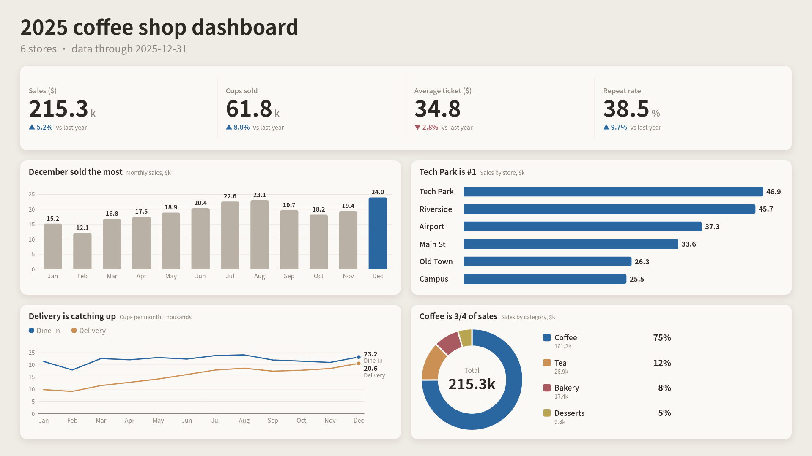
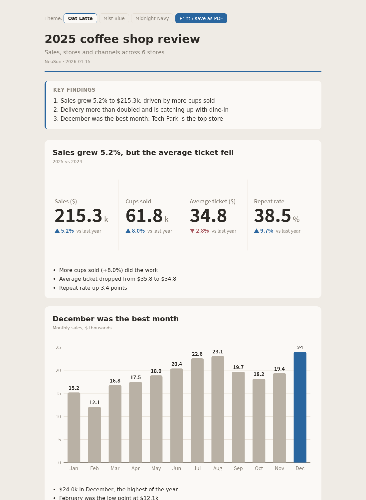
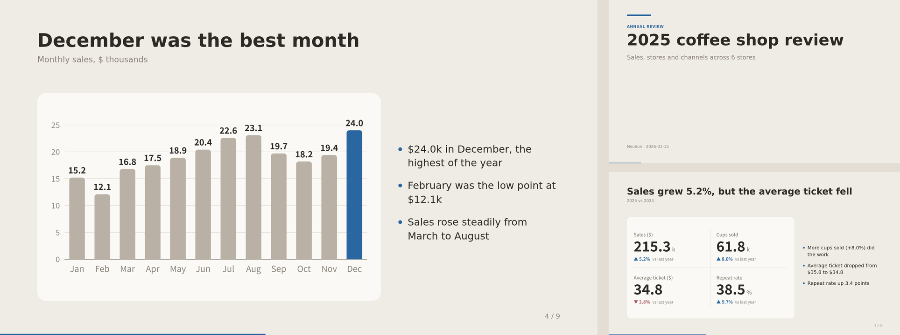

# AI Data Report Skill：说出想知道什么，AI 选对图、做出报表

一个给 Claude Code 等 AI 助手用的 **Skill**。告诉它你想知道什么（「哪家店有问题」「今年做得怎么样」），它判断该用哪几种图来回答，做成能直接用的**图表、一页数据看板、可打印的报告或 HTML 幻灯片**。数据可以来自 Excel、CSV、粘贴的表格、数据库或 BI 的查询结果，也可以是你在对话里给的数。不联网：AI 生成一个 HTML 文件，用浏览器打开就行。

**在线示例**（浏览器直接打开，虚构的咖啡店数据）：[图片和看板](https://neosunxz.github.io/ai-data-report-skill/examples/demo.html) · [报告](https://neosunxz.github.io/ai-data-report-skill/examples/report.html) · [幻灯片](https://neosunxz.github.io/ai-data-report-skill/examples/slides.html)

[English](README.md) · 作者 **NeoSun**



## 能做什么

- **从你的问题出发，不从图名出发**：常见需求对应一套报表方案。比如「哪家店有问题」→ 数字卡、谁没达标（子弹图）、谁比去年掉了（哑铃图）、哪几天掉的（日历热力图）。数据撑不起来的图会去掉，并说明原因。
- **结论不说过头**：不编行业均值，没有依据不说「因为」，数据少就说少，「显著」「大幅」这类词都换成具体的数。
- **同一份数据，四种输出**：
  - **图片**：每张图有 3:4（手机）、16:9（PPT）和透明背景的「只下载图」，放进任何模板都行。
  - **看板**：一排数字卡加 2–6 张图拼成一页，16:9 或手机长图。
  - **报告**：一个长网页：主要发现、每节一张图配解读、数据说明；能打印成 A4 PDF。
  - **幻灯片**：16:9 的 HTML 幻灯片，方向键翻页、可全屏，打印成 PDF 一页一张。
- **和别的幻灯片 Skill、模板一起用**：在用 [frontend-slides](https://github.com/zarazhangrui/frontend-slides)、别的做 PPT 的 Skill 或公司模板？这个 Skill 只写内容大纲、按对方的颜色和字体画图，不动对方的设计。HTML 幻灯片给嵌入代码，PowerPoint、Keynote、WPS 给透明背景 PNG。
- **17 种图**：条形图、柱形图、折线图、环形图、堆积柱形图、瀑布图、数字卡、哑铃图、华夫饼图、子弹图、日历热力图（一年排一条）、月历热力图、图片卡（带图片和排名的商品墙）、方块地图（中国各省或美国各州，不联网、不画边界）、散点图、雷达图、表格。条形图和柱形图还能画成**分组、堆积和 100% 堆积**，用来并排比较几组数，或者比较各项的构成。
- **3 套配色或你自己的颜色**：燕麦拿铁、雾霾蓝、深夜蓝（深色），也可以传入任何一套颜色。
- **不懂数据也能用**：AI 先问给谁看、最关心哪几个数、和什么比；表格里有多个 sheet、合并单元格、日期写成文字这类情况，它会先整理，再告诉你改了什么。
- **不编数**：图里的每个数都来自你的数据，汇总时会说明怎么算的。
- **数据从哪来都行**：Excel、CSV、粘贴的表格、数据库或 Power BI 的查询结果（比如通过 MCP 查的），或者对话里给的数。
- **能查数、也能读屏**：报告和幻灯片里每张图都有一个默认收起的「显示数据表」，展开就是图背后的原始数字；每张图还带一句供屏幕阅读器朗读的说明。
- **改了什么会告诉你**：认不出的数值、认不出的日期、没画出来的行，都会列在页面的「数据提醒」里，不会悄悄丢掉。
- **中英文**：示例是英文的；用中文跟 AI 说，它就出中文的图和页面。


| 报告 | 幻灯片 |
|---|---|
|  |  |

## 安装

**Claude Code（插件）**：

```
/plugin marketplace add NeoSunxz/ai-data-report-skill
/plugin install data-report@neosun-skills
```

**支持 skills 命令行的 AI 助手**（Claude Code、Codex、Cursor 等）：

```bash
npx skills add NeoSunxz/ai-data-report-skill
```

**手动安装**：把 `skills/data-report` 文件夹复制到 `~/.claude/skills/`（所有项目可用）或项目里的 `.claude/skills/`。

```bash
git clone https://github.com/NeoSunxz/ai-data-report-skill.git
cp -r ai-data-report-skill/skills/data-report ~/.claude/skills/
```

**其他 AI 助手**：把 `skills/data-report/SKILL.md` 和 `skills/data-report/template.html` 一起当附件发给它，说「按这份说明做」。Skill 正文是英文，用中文跟 AI 说话就行，它会出中文图。

## 怎么用

1. 把数据交给 AI，说你想知道什么或者要什么：「哪家店在掉队」「淡季旺季怎么分」「做个看板」「做成 6 页 PPT」。
2. AI 会生成一个 HTML 文件，用 Chrome 或 Edge 打开。
   - 图片和看板：点下载按钮。
   - 报告：点顶部的「打印 / 存成 PDF」。
   - 幻灯片：← → 翻页，F 全屏，打印可以存成 PDF。

想先看效果，直接打开在线示例：[图片和看板](https://neosunxz.github.io/ai-data-report-skill/examples/demo.html)、[报告](https://neosunxz.github.io/ai-data-report-skill/examples/report.html)、[幻灯片](https://neosunxz.github.io/ai-data-report-skill/examples/slides.html)，里面是虚构的咖啡店数据。同样的文件在 [`examples/`](examples/) 里，也可以下载到本地打开。

## 限制

- 网页里鼠标移到图上能看到具体的数，手机上点一下也行；但不能点选、筛选，数据更新了要重新生成。
- 内置幻灯片故意做得很朴素（标题、一张图、几条要点）。想要动画多、设计感强的幻灯片，搭配专门做幻灯片的 Skill 用。
- 每种图有行数上限（比如条形图最多 15 行、柱形图 24 根、折线图 60 个点）。超出的部分直接不画，不会悄悄合并进去，图上会注明少了多少行；柱形图和折线图保留最新的数据。
- 带货币符号或单位的数（`"$3,200"`、`"12k"`、`"15%"`）不会被猜测，会列进页面的「数据提醒」。日期要是年在前的：`2025-03-05`、`2025/3/5` 或 `20250305`（Excel 日期序号也行）；`3/5/2025` 分不清月日，不会乱猜。
- 图里的文字用电脑自带字体，不同电脑上字形略有差别。
- 网页只在你的浏览器里运行，数据不会上传。

## 开源协议

[MIT](LICENSE) © NeoSun
